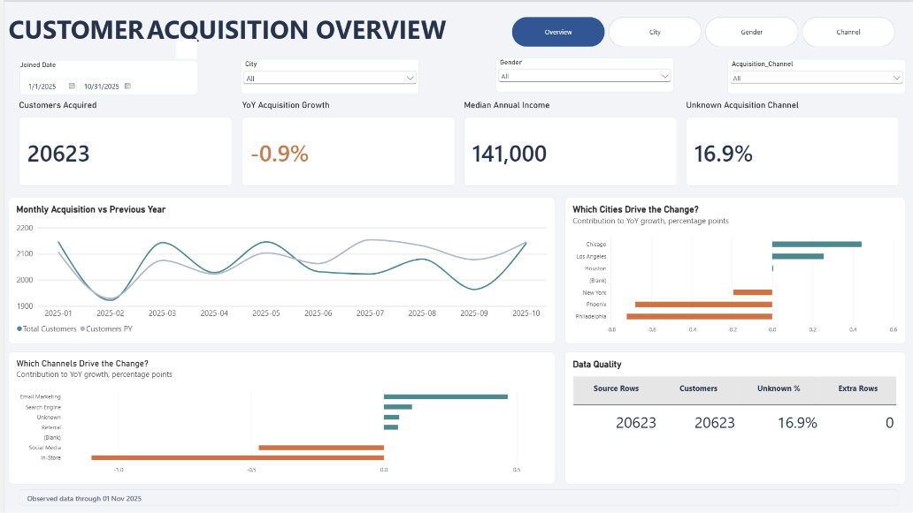
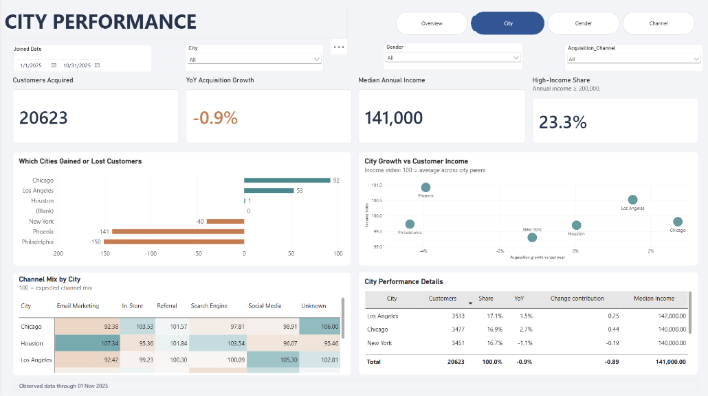
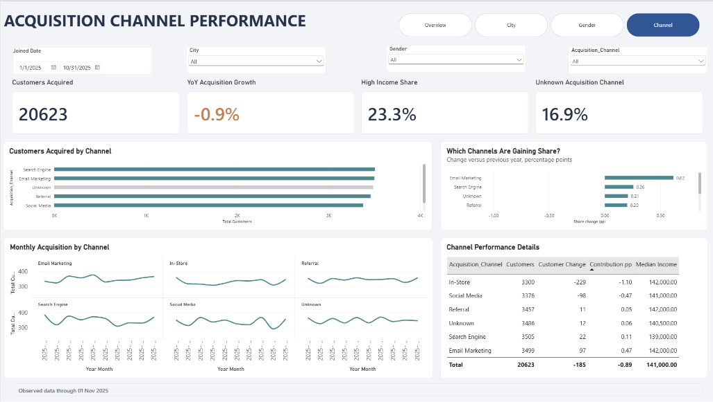

# Customer Acquisition Analysis Dashboard

An interactive Power BI dashboard that tracks how many new customers join each month and explains **which cities and acquisition channels drive the change**.

## Business question

Customer acquisition fell in 2025. Where is the decline coming from, and what should the business look at first?

## Key findings (Jan–Oct 2025 vs Jan–Oct 2024)

- New customers fell **1.3%** (20,896 → 20,623).
- **In-Store** was the biggest driver: −245 customers (**−6.9%**). Email Marketing was the only channel with clear growth (+2.5%).
- **Philadelphia (−4.9%)** and **Phoenix (−4.2%)** declined the most; Chicago grew (+2.3%).
- **16.9%** of customers have an *Unknown* acquisition channel, which limits how precisely growth can be attributed.

November 2025 is excluded from the comparison because the data ends on 1 Nov 2025.

## Recommendation

Prioritize a review of the In-Store channel and of the Philadelphia and Phoenix markets, and improve channel tracking at sign-up to reduce the Unknown share.

## Dashboard pages

| Page | What it answers |
| --- | --- |
| Overview | Monthly acquisition vs last year; which cities and channels drive the change; data quality checks |
| City | Which cities gained or lost customers; city growth vs customer income; channel mix by city |
| Gender | Monthly acquisition by gender; income by age band and gender |
| Channel | Customers and share by channel; which channels are gaining share |

A custom tooltip page shows segment details (customers, YoY growth, median income, P25/P75) on hover.

| City | Channel |
| --- | --- |
|  |  |

## Data model

Star schema with one fact table and five dimensions:

- **Fact Customer**: 95,080 customers (join date, income, age at join, and keys to each dimension)
- **Dim Date**, **Dim City**, **Dim State**, **Dim Gender**, **Dim Acc_Channel**

## How it was built

- **Power Query** ([`power_query/`](power_query)): cleaned the raw customer file, built dimension tables with surrogate keys, and enriched the data with a US state table scraped from Wikipedia.
- **DAX** ([`dax/measures.dax`](dax/measures.dax)): 49 measures, including YoY and MoM growth, each city's and channel's contribution to growth (percentage points), channel mix shift, income percentiles (P25, median, P75) and data quality checks (duplicate rows, unknown channel share).
- **Period handling**: YoY compares only matching dates, and the dashboard flags partial months so a short final month is not misread as a decline.

## Tools

Power BI Desktop · Power Query (M) · DAX

## Data

CyberSoft Academy course dataset. 
